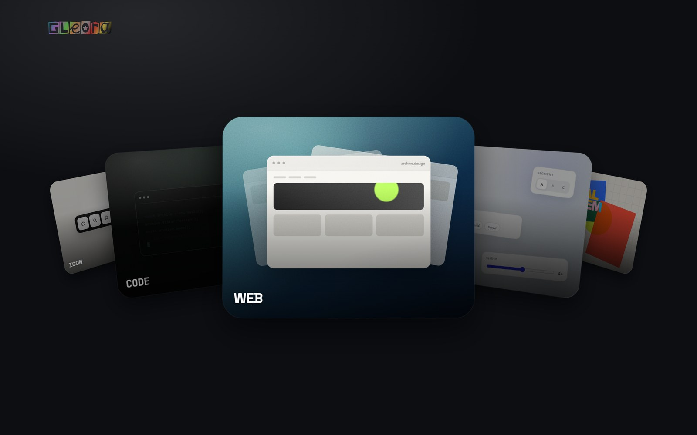
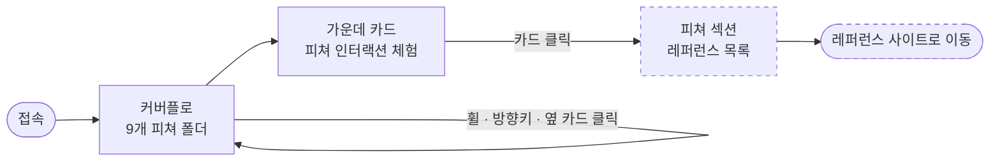
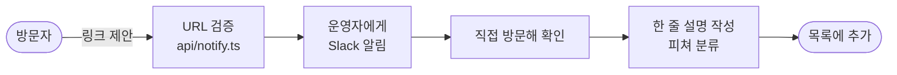
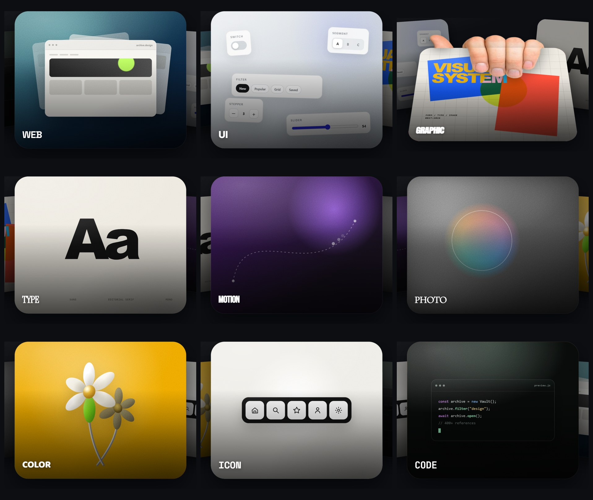
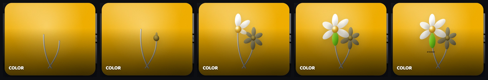
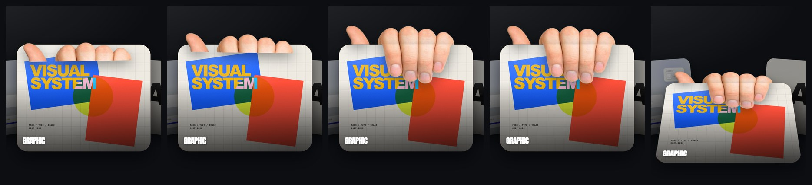

# Gleora

**디자인 레퍼런스를 "무엇에 관한 것인가"로 묶어, 폴더를 넘기듯 탐색하는 개인용 갤러리.**



> **현재 단계 — 디자인 프로토타입**
> 새 디자인은 [`public/prototype.html`](public/prototype.html) 한 파일에서 만들고 있다.
> `src/` 의 React 앱은 아직 이전 버전([Reference Vault](https://github.com/thvlou/Reference_vault))이며,
> 프로토타입이 확정되면 앱으로 옮긴다.

| | |
|---|---|
| 성격 | 비상업 개인 사이드 프로젝트 |
| 이전 버전 | Reference Vault — 레퍼런스 26개, 한 줄 목록형 |
| 목표 규모 | 레퍼런스 300~500개 |
| 상태 | 메인 탐색 화면 프로토타입 완료 · 피쳐 섹션 미구현 |

---

## 목차

1. [개요](#1-개요)
2. [목표와 비목표](#2-목표와-비목표)
3. [사용법](#3-사용법)
4. [사용자 플로우](#4-사용자-플로우)
5. [정보 구조](#5-정보-구조)
6. [디자인](#6-디자인)
7. [동작 원리](#7-동작-원리)
8. [데이터와 큐레이션](#8-데이터와-큐레이션)
9. [기술 스택과 구조](#9-기술-스택과-구조)
10. [현재 상태와 로드맵](#10-현재-상태와-로드맵)
11. [문서](#11-문서)

---

## 1. 개요

### 1-1. 왜 다시 만드는가

이전 버전 Reference Vault 는 레퍼런스 26개를 한 줄씩 늘어놓고, 이름에 커서를 올리면
3D 로고가 따라오는 무한 벨트였다. 26개에서는 두세 바퀴면 전부 볼 수 있어서 이 방식이 즐거웠다.

**문제는 규모다.** 목표인 300~500개가 되면 "전부 훑어보기"라는 전제가 무너진다.

| | 26개일 때 | 500개일 때 |
|---|---|---|
| 끝없는 목록에서 찾기 | 두세 바퀴면 다 봄 | 영원히 못 찾음 |
| 분류 · 검색 | 필요 없음 | **없으면 치명적** |
| 한 화면에 전부 | 적절 | 정보 계층이 없어 길을 잃음 |

비교 대상으로 레퍼런스 565개를 모아 둔 아카이브(Freesources)를 실측해 보니, 검색·필터가 없고
설명이 한 줄도 없으며 링크의 15.9%가 죽어 있었다.
**많이 모으는 것만으로는 좋은 아카이브가 되지 않는다.** 승부처는 규모가 아니라
**찾아지는 것**, 그리고 **무엇인지 바로 알 수 있는 것**이다.

### 1-2. 핵심 아이디어

**① 폴더 = 피쳐.** 레퍼런스를 "그 사이트가 무엇에 관한 것인가"로 나눈 9개 폴더(피쳐)로 묶는다.
첫 화면은 레퍼런스 목록이 아니라 이 9개 폴더다.

**② 카드가 곧 설명이다.** 각 폴더 카드는 이름표 대신 그 피쳐를 **직접 체험시킨다.**
COLOR 카드에서는 꽃잎을 건드리면 색 코드가 나오고, UI 카드에서는 스위치와 슬라이더가 실제로 움직인다.
"UI 레퍼런스"라는 말을 읽기 전에 손이 먼저 이해하게 하는 것이 목표다.

**③ 장난감 같은 감각은 지킨다.** 이전 버전이 좋았던 이유는 도구가 아니라 사물처럼 느껴졌기 때문이다.
규모를 키우되 그 감각은 잃지 않는다.

---

## 2. 목표와 비목표

### 목표

| 지표 | 목표 |
|---|---|
| 원하는 레퍼런스까지 걸리는 시간 | 10초 이내 — 폴더 선택 + 한 번 더 |
| 설명 커버리지 | 100% — 모든 항목에 한글 한 줄 설명 |
| 죽은 링크 비율 | 3% 미만 — 주기적 점검 |
| 첫 화면의 인상 | 9개 폴더만으로 "무엇을 모아 둔 곳인지" 전달 |

### 비목표 (하지 않는다)

- **로그인 · 계정** — 개인 프로젝트 범위를 넘고 개인정보 부담이 생긴다
- **서버 DB** — 수백 개 규모는 정적 데이터로 충분하다
- **댓글 · 좋아요 · 랭킹** — 큐레이션의 색깔이 흐려진다
- **상업화** — 저작권상 안전한 범위가 급격히 좁아진다

---

## 3. 사용법

### 실행

```bash
npm install
npm run dev
```

브라우저에서 **`http://localhost:5173/prototype.html`** 을 연다.

### 조작

| 입력 | 동작 |
|---|---|
| 마우스 휠 | 한 칸에 카드 한 장. 빠르게 굴리면 그만큼 빠르게 넘어간다 |
| ← → 방향키 | 카드 한 장씩 이동 |
| 옆 카드 클릭 | 그 카드가 가운데로 온다 |
| 가운데 카드 클릭 | 피쳐 섹션으로 진입 *(섹션은 아직 미구현 — 지금은 반응 없음)* |
| 가운데 카드 안의 요소 | 카드마다 다른 인터랙션 ([6-4](#6-4-카드별-인터랙션) 참고) |

카드 안 인터랙션은 **가운데 카드에서만** 동작한다. 옆 카드는 완성된 정지 화면으로 보인다.

---

## 4. 사용자 플로우

### 탐색



점선은 아직 구현하지 않은 단계다.

### 레퍼런스 제안 → 큐레이션

방문자가 좋은 사이트를 알려줄 수 있다. **제안은 자동 등록되지 않는다** — 운영자에게 알림만 가고,
사람이 직접 확인한 뒤 설명과 분류를 붙여 추가한다.



> 제안 입력창을 여는 버튼(이전의 "Hit me")은 새 디자인에 맞지 않아 지웠다.
> 제안 기능 자체는 남아 있고, 새 진입점은 재설계 예정이다.

---

## 5. 정보 구조

### 5-1. 피쳐 — 9개 폴더

레퍼런스를 **그 사이트가 무엇에 관한 것인가**로 나눈다. 한 사이트가 여러 피쳐에 속할 수 있다.

| 피쳐 | 담는 것 | 라벨 서체 | 카드 바탕 |
|---|---|---|---|
| **WEB** | 웹사이트 · 랜딩 페이지 · 포트폴리오 | Space Grotesk | 틸 → 딥 블루 |
| **UI** | 컴포넌트 · 디자인 시스템 · 앱 화면 | Inter | 쿨 그레이 |
| **GRAPHIC** | 포스터 · 편집 · 브랜딩 | Anton | 아이보리 종이 + 원색 포스터 |
| **TYPE** | 서체 · 타이포그래피 | Instrument Serif | 아이보리 종이 |
| **MOTION** | 애니메이션 · 인터랙션 | Bebas Neue | 딥 바이올렛 |
| **PHOTO** | 사진 · 이미지 소스 | Cormorant Garamond | 흑백 |
| **COLOR** | 팔레트 · 색 도구 | Baloo 2 | 골드 |
| **ICON** | 아이콘 · 심볼 | Space Mono | 라이트 그레이 |
| **CODE** | 개발 · 코드 스니펫 | JetBrains Mono | 터미널 블랙 |

라벨 서체는 피쳐의 성격을 그대로 보여주는 것으로 골랐다 — TYPE 은 세리프, CODE 는 모노스페이스.

### 5-2. 목적 — 두 번째 축 (설계)

피쳐 하나로는 "모션 레퍼런스인데 영감용이 아니라 도구인 것"을 바로 찾을 수 없다.
그래서 **목적**을 교차 축으로 둔다.

| 목적 | 정의 |
|---|---|
| inspiration | 보고 자극받는 곳 — 갤러리, 쇼케이스 |
| asset | 받아서 쓰는 것 — 폰트, 목업, 아이콘, 스톡 |
| tool | 브라우저에서 작업하는 것 — 생성기, 에디터 |
| reading | 읽는 것 — 매거진, 가이드 |
| community | 사람 · 직군 디렉토리 |

피쳐 × 목적으로 거르면 예를 들어 **TYPE × asset = 무료 폰트**만 남는다.
목적 축은 피쳐 섹션을 만들 때 함께 들어간다.

---

## 6. 디자인

### 6-1. 시각 언어

| 요소 | 결정 | 이유 |
|---|---|---|
| **배경** | 유광 블랙 — 좌상단에서 빛이 들어오는 넓은 반사광 | 카드의 광택도 좌상단 광원이다. 같은 방향이어야 카드와 배경이 한 공간에 있는 것으로 읽힌다 |
| **배경 밝기** | 순검정이 아니라 살짝 띄운 쿨 블랙 | 너무 어두우면 카드의 드롭섀도가 들어갈 자리가 없어 카드가 떠 보이지 않는다 |
| **로고** | 글자마다 색 블록에 들어간 장식 서체, 9색 그라디언트 | 9색이 곧 9개 피쳐다. 5초마다 유리에 빛이 스치는 광택이 지나간다 |
| **카드** | 피쳐마다 다른 색 · 서체 · 내부 장면 | 폴더 안은 피쳐의 개성, 폴더 밖(배경 · 로고)은 하나의 톤으로 둔다 |

### 6-2. 레이아웃 — 하나의 기준선

로고의 왼쪽 끝과 카드군의 좌우 끝이 **모두 화면 가장자리에서 100px** 선 위에 놓인다.

카드는 고정 크기(500 × 400)로 가운데 정렬되므로, 그냥 두면 화면이 넓을수록 여백이 커지고 좁을수록 잘린다
(1200px 화면에서 4px, 1920px에서 364px). 그래서 기준선을 카드에 맞추는 대신
**카드군 전체를 확대 · 축소해 기준선에 맞춘다.** 약 1030~1810px 너비에서 정확히 일치한다.

### 6-3. 모션 원칙

| 원칙 | 적용 |
|---|---|
| 한 번의 입력엔 한 번의 이동 | 휠 한 칸 = 카드 한 장. 단, 빠르게 굴리면 그만큼 더 넘어간다 |
| 움직임은 가운데에서만 | 반복 애니메이션 · 커서 반응은 가운데 카드에서만 돈다. 옆 카드는 정지 |
| 사물처럼 | 튕기고, 피어나고, 무게로 내려앉는다. 화면 요소가 아니라 물건처럼 움직인다 |
| 줄일 수 있어야 한다 | 시스템의 "동작 줄이기" 설정을 켜면 반복 애니메이션이 멈춘다 |

| 대상 | 길이 | 비고 |
|---|---|---|
| 카드 이동 | 0.8s | `cubic-bezier(.22, 1, .36, 1)` |
| 로고 광택 | 5s 주기 | 그중 1.4s 만 스치고 나머지는 쉰다 |
| COLOR 개화 | 1.4s | 줄기 → 봉오리 → 꽃잎 순 |
| GRAPHIC 손 | 약 4.4s | 대기 → 기어오름 → 쥠 → 낙하 |

### 6-4. 카드별 인터랙션



| 카드 | 보여주는 것 | 인터랙션 |
|---|---|---|
| **WEB** | 브라우저 페이지 3장이 겹친 스택 | 페이지들이 천천히 깊이를 바꾸며 움직인다 |
| **UI** | 서로 떨어진 5개의 UI 부품 | 스위치 · 세그먼트 · 필터 칩 · 슬라이더 · 스테퍼가 **실제로 조작된다** |
| **GRAPHIC** | 스위스 스타일 편집 포스터 | 커서를 따라 레이어마다 다른 양으로 움직인다. 선택하면 손이 카드를 잡는다 ([6-6](#6-6-graphic--손이-카드를-잡는다)) |
| **TYPE** | 큰 `Aa` 견본 | Sans → Editorial Serif → Mono 로 계속 바뀐다 |
| **MOTION** | 이징 커브 | 점과 잔상이 곡선을 따라 달린다 |
| **PHOTO** | 흑백 사진 | 커서 주변만 원래 색이 돌아온다 |
| **COLOR** | 3D 데이지 두 송이 | 줄기부터 자라 피어나고, 꽃잎을 가리키면 빠지며 색 코드가 보인다 ([6-5](#6-5-color--피어나는-꽃)) |
| **ICON** | 아이콘 독 | 가리킨 아이콘이 가장 많이, 이웃은 조금 덜 올라온다 |
| **CODE** | 작은 터미널 | 코드가 한 줄씩 나타나고 커서가 깜빡인다 |

### 6-5. COLOR — 피어나는 꽃



| ① 0.3s | ② 0.8s | ③ 1.2s | ④ 완성 | ⑤ 호버 |
|---|---|---|---|---|
| 줄기가 아래에서 자란다 | 줄기 끝에 봉오리가 맺힌다 | 꽃잎이 하나씩 펼쳐진다 | 두 송이가 서로 반대쪽을 본다 | 꽃잎이 빠지며 색 코드가 나온다 |

- 꽃잎 6장 중 5장은 서로 다른 흰색, **한 장만 `#7EE01D`** 다. 흰 꽃 속의 한 장이 시선을 잡는다.
- 꽃잎은 SVG 로 그렸다. 사각형을 둥글린 것으로는 휘어진 꽃잎 표면이 나오지 않는다.
- 빛은 여섯 장 모두 좌상단 한 곳에서 오도록 맞췄다 — 배경 · 카드 광택과 같은 방향이다.

### 6-6. GRAPHIC — 손이 카드를 잡는다



| ① | ② | ③ | ④ | ⑤ |
|---|---|---|---|---|
| 카드 뒤에서 손끝이 빼꼼 | 멈칫하며 기어오른다 | 손가락이 모서리를 넘어온다 | 카드를 쥔다 | 손의 무게에 카드가 아래로 쿵, 뒤로 젖혀진다 |

- 카드는 손에 끌려 **카드 높이의 20% 아래로, 45° 뒤로** 젖혀지며 한 번 튕긴 뒤 멈춘다.
- 다른 카드로 넘어가면 손은 바로 사라지고 카드는 빠르게 제자리로 돌아온다.

---

## 7. 동작 원리

### 7-1. 커버플로 배치

카드 배치는 Originkit 의 CoverflowGallery 계산식을 바탕으로, 가장자리 카드가 **링을 따라 뒤로 말려 들어가도록**
곡률을 더했다. 가운데에서 몇 칸 떨어졌는지(`rel`)만으로 모든 카드의 위치가 정해진다.

```
a      = rel × 30°                                  링 위의 각도
x      = R · sin(a) × (1 + max(0, |rel| − 1) × 0.19)  가장자리일수록 조금 더 벌린다
z      = −|rel| × 240 − R · (1 − cos a)              멀어질수록 뒤로
회전Y  = −rel × 16° − rel × 30° × 0.35              링을 따라 돌아간다
회전Z  = rel × 6°
크기   = 1 − |rel| × 0.16
                                    (R = 355 / sin 30°,  원근 1600px)
```

화면에는 가운데와 좌우 두 장씩, **항상 5장**만 보인다. 나머지는 링 뒤로 숨는다.
9장이 끝없이 돌아가므로 처음과 끝이 없다.

### 7-2. 휠 — "한 칸에 한 장"

휠은 기기마다 한 칸에 오는 값이 다르다(마우스 100px, 트랙패드는 작은 값 수십 개).
그래서 거리로 세지 않고 **제스처 단위로** 센다.

- 휠 입력이 **120ms 이상 끊겼다가** 다시 오면 → 새 제스처 → 즉시 한 장
- 같은 제스처가 이어지는 동안 **520px 쌓일 때마다** → 한 장 더

결과적으로 천천히 한 칸씩 굴리면 정확히 한 장씩, 세게 굴리면 그만큼 빨리 넘어간다.

### 7-3. 기준선에 맞추는 확대 · 축소

```
배율 = clamp( 0.70,  (화면폭 / 2 − 100) / 596,  1.35 )
```

596 은 배율 1 일 때 화면 중심에서 가장 바깥 카드 끝까지의 거리(실측)다.
상한 · 하한은 화면이 아주 넓거나 좁을 때 카드가 지나치게 커지거나 작아지지 않게 한다.

### 7-4. 카드 안에 효과를 넣는 방식

카드 하나는 여러 겹으로 되어 있다. 피쳐 효과는 **기본 색 바로 위 한 겹에만** 들어간다.

```
비활성 딤          가운데가 아닐 때 어둡게
라벨               WEB, UI …
하단 그라디언트     라벨 가독성
그레인 · 광택       카드의 재질감
피쳐 효과          ← 여기만 추가 (.feature-fx)
기본 색 그라디언트
```

광택 · 그레인 · 라벨이 그대로 위에 얹히므로 카드마다 내용은 달라도 같은 재질로 보인다.
카드의 크기 · 배치 · 라벨 · 클릭 동작은 건드리지 않는다는 원칙으로 붙였다.

### 7-5. GRAPHIC 손의 구조

손 사진에는 손바닥이 없다. 그대로 움직이면 사진의 잘린 단면이 드러난다.
그래서 사진을 **손가락 마디선에서 두 장으로 잘랐다.**

```
          ┌──────────────┐
  손등 ── │   카드 뒤     │  ← 기어오르는 동안 카드에 가려져 잘린 단면이 안 보인다
 ─────────┼── 카드 윗변 ──┼───────────────
  손가락 ─ │   카드 앞     │  ← 윗변을 경첩 삼아 앞으로 넘어온다
          └──────────────┘
```

- 카드는 그 안의 내용이 밖으로 넘치지 않게 잘라내므로, 손은 카드 안이 아니라 **카드 옆에 같은 크기의 틀을 하나 더 두고** 그 위에 얹었다.
- 카드가 내려앉을 때는 캐러셀이 쓰는 위치값을 덮어쓰지 않고 **그 위에 더한다** (Web Animations `composite: 'add'`). 캐러셀 계산식을 건드리지 않고 연출만 얹을 수 있다.

### 7-6. 3D 안에서 지킨 규칙

- 3D 로 배치된 요소에는 `filter` · `mask` 를 직접 걸지 않는다. 걸면 3D 가 평면으로 눌린다.
  움직이는 요소와 그림자 · 마스크를 거는 요소를 **안팎 두 겹으로 나눈다.**
- 카드 평면을 앞뒤로 통과하는 움직임은 피한다. 통과하는 순간 앞뒤 순서가 뒤집히며 튄다.

---

## 8. 데이터와 큐레이션

### 8-1. 현황

| 출처 | 개수 | 상태 |
|---|---|---|
| Reference Vault 기존 목록 | 26 | 한 줄 설명 완비 |
| 외부 아카이브에서 얻은 후보 | 533 | 링크 생존 검증 완료, 설명 없음 |
| 최종 목표 | 300~500 | — |

### 8-2. 저작권 원칙

- 사이트 이름과 주소는 **사실**이라 보호 대상이 아니다.
- 다른 아카이브가 고른 **목록 전체와 분류 체계**는 편집물로 보호될 수 있다 — 그대로 복제하지 않는다.
- 후보는 **출발점으로만** 쓴다. 각 사이트를 직접 확인하고, **설명은 직접 쓰고**, **분류는 우리 체계로** 다시 한다.
- 이 과정이 곧 이 프로젝트의 차별점이다 — 설명이 있고 다시 분류된 목록.

### 8-3. 파이프라인

```
[1] 후보 확보          533개              완료
[2] 링크 생존 검증      DNS · HTTP 실측     완료
[3] 메타데이터 수집     제목 · 소개문        진행
[4] 한 줄 설명 작성     직접 작성            다음
[5] 피쳐 · 목적 분류                         다음
[6] 최종 선별          300~500개
```

링크 검증에서 배운 것: 응답 거부(403 · 429)는 봇 차단일 뿐 사이트는 살아 있는 경우가 많고,
반대로 응답은 정상(200)인데 도메인이 팔려 전혀 다른 사이트가 된 경우도 있었다.
**주소가 사라진 것과 404 · 410 만** 죽은 링크로 본다.

---

## 9. 기술 스택과 구조

### 스택

| 영역 | 선택 |
|---|---|
| 프로토타입 | HTML 한 파일 + CSS + 바닐라 JS. 외부 라이브러리 없음 (웹폰트만 Google Fonts) |
| 앱 | Vite 8 · React 19 · TypeScript 6 · CSS Modules · framer-motion 13 |
| 라우터 · 상태관리 | 없음 — 단일 화면이라 필요 없다 |
| 백엔드 | Vercel Edge Function 1개 + Slack 알림 |

라우터 · 상태관리 라이브러리 · CSS 프레임워크는 의도적으로 넣지 않았다.
이 규모에서는 필요 없고, 직접 만든 인터랙션을 오히려 방해했다.

### 폴더 구조

```
gleora/
├─ public/                     정적 파일 (개발 서버 루트)
│  ├─ prototype.html           리디자인 프로토타입 — 현재 작업 대상
│  ├─ gleora-logo.svg
│  ├─ hand-knuckles.png        GRAPHIC 손 — 손등 (카드 뒤)
│  ├─ hand-fingers.png         GRAPHIC 손 — 손가락 (카드 앞)
│  └─ fonts/
│
├─ src/                        React 앱 — 아직 이전 버전
├─ api/notify.ts               링크 제안 → Slack 알림
│
├─ design/                     앱에 들어가지 않는 디자인 자료
│  ├─ explorations/            지나온 탐색안
│  └─ assets/                  원본 소스 (손 원본 사진, 로고 원본)
│
└─ docs/
   ├─ images/                  이 문서의 이미지
   └─ …                        기획 · 기록 문서
```

### 명령어

| 명령 | 용도 |
|---|---|
| `npm run dev` | 개발 서버 — 프로토타입은 `/prototype.html` |
| `npm run build` | 타입 검사 + 앱 빌드 |
| `npm run lint` | 린트 |
| `vercel dev` | Slack 알림까지 포함해 실행 |

Slack 알림을 확인하려면 `.env.example` 을 참고해 `.env.local` 에 `SLACK_WEBHOOK_URL` 을 넣는다.
`.env*` 파일은 커밋되지 않는다.

---

## 10. 현재 상태와 로드맵

### 완료

- 3D 링 커버플로, 휠 · 방향키 · 클릭 이동, 화면 너비별 기준선 맞춤
- 9개 피쳐 카드 내부 인터랙션
- COLOR 개화 · GRAPHIC 손 연출
- 로고 광택, 유광 배경

### 알려진 문제

| 문제 | 원인 | 방향 |
|---|---|---|
| GRAPHIC 손가락이 넘어올 때 늘어나 보인다 | 사진 한 장으로는 손가락이 접히는 동작을 만들 수 없다 | 접히는 단계별 손 이미지로 교체 예정 |
| 손가락 윗부분이 밝게 끊겨 보인다 | 사진을 자른 경계에서 밝기가 자연스럽게 이어지지 않는다 | 손 이미지 교체 때 함께 해결 |
| PHOTO 카드가 실제 사진이 아니다 | 아직 사진 자산이 없어 그라디언트를 임시로 씀 | 사진 확보 후 한 줄 교체 |
| 레퍼런스 제안 진입점이 없다 | 이전 버튼을 지웠다 | 새 디자인에 맞게 재설계 |

### 다음 단계

| 단계 | 내용 |
|---|---|
| **M1. 피쳐 섹션** | 가운데 카드를 누르면 들어가는 레퍼런스 목록 화면 |
| **M2. 데이터** | 설명 작성 · 분류 · 최종 선별 → 300~500개 |
| **M3. 앱 이식** | 프로토타입을 `src/` React 앱으로 옮긴다 |
| **M4. 운영** | 죽은 링크 주기 점검 + 알림 |
| **M5. 다듬기** | 모바일 · 접근성 · 성능 |

### 결정이 필요한 것

- 최종 개수 — 300개(엄선) vs 500개(포괄)
- 폰트 사이트 포함 범위 — 라이선스 문제로 공식 파운드리만 둘지
- 레퍼런스 제안 진입점의 형태

---

## 11. 문서

| 파일 | 내용 |
|---|---|
| [`docs/prd-v1.md`](docs/prd-v1.md) | 리디자인 기획서 초안 — 문제 정의, 기능 명세, 기술 설계 |
| [`docs/devlog.md`](docs/devlog.md) | 작업 로그와 트러블슈팅 — 무엇을 왜 그렇게 했는지 |
| [`docs/pattern-research.md`](docs/pattern-research.md) | 피쳐별 패턴 설계 근거 |
| [`docs/batch-01-design.md`](docs/batch-01-design.md) | 첫 레퍼런스 묶음 설계 |
| [`docs/reference-vault-log.md`](docs/reference-vault-log.md) | 이전 버전 Reference Vault 제작 기록 |

`docs/devlog.md` 안의 파일 경로는 기록 당시 이름 그대로다
(예: `folder-ui-preview.html` → 현재 `public/prototype.html`).

이전 버전은 [thvlou/Reference_vault](https://github.com/thvlou/Reference_vault) 에 따로 보관한다.
